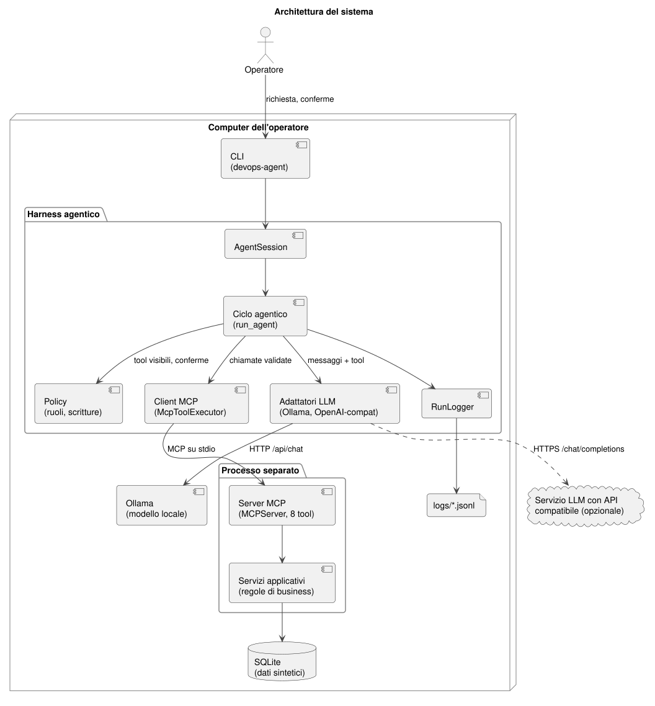

# Agent per le richieste operative di un team Cloud/DevOps

## Architettura



| Componente | Percorso | Ruolo |
|---|---|---|
| Back-end | `src/devops_agent/backend/` | Schema SQLite, regole di business, dati sintetici deterministici |
| Server MCP | `src/devops_agent/mcp_server/` | 8 tool tipizzati (5 di lettura, 3 di scrittura), trasporto stdio |
| Harness | `src/devops_agent/agent/` | Ciclo agentico, policy per ruolo, client MCP, adattatori dei modelli, log JSONL |
| CLI | `src/devops_agent/cli.py` | Comandi `init-db`, `tools`, `ask`, `chat`, `scenarios`, `tokens` |
| Valutazione | `src/devops_agent/evaluation/` | Esecuzione degli scenari, report, analisi token e costi |
| Scenari | `tests/scenarios/*.toml` | 18 scenari di test con esito atteso verificabile, anche su più turni di chat; in `regressione/` due scenari con risposte registrate |
| Documentazione | `docs/` | UML, schema ER, schede dei tool, tracciabilità dei requisiti |

## Requisiti

- Python 3.11 o superiore
- [Ollama](https://ollama.com) per il modello locale, con un modello che supporti il *tool calling*
  (default: `qwen2.5:7b`; da verificare sul proprio hardware)
- In alternativa, un servizio con API compatibile *Chat Completions* (vedi `config.example.toml`)

## Installazione

Windows (PowerShell):

```powershell
py -3.12 -m venv .venv
.venv\Scripts\Activate.ps1
pip install -e ".[dev]"
copy config.example.toml config.toml #può essere omesso in quanto ho committato config.toml nel repo
ollama pull qwen2.5:7b
devops-agent init-db
```

Linux e macOS:

```bash
python3 -m venv .venv
source .venv/bin/activate
pip install -e ".[dev]"
cp config.example.toml config.toml #può essere omesso in quanto ho committato config.toml nel repo
ollama pull qwen2.5:7b
devops-agent init-db
```

`init-db` crea `data/devops.db` con 8 servizi, 4 team, 16 pipeline e 30 richieste. Con lo
stesso seed (default 42) il contenuto è sempre identico.

## Uso

```bash
devops-agent tools                       # tool del server e classificazione per il ruolo corrente
devops-agent ask "Com'è andato l'ultimo deploy di customer-portal in produzione?"
devops-agent chat                        # conversazione; /reset azzera, /esci termina
devops-agent --role viewer chat          # stesso agente, ruolo di sola lettura
devops-agent --model llama3.1:8b chat    # altro modello, nessuna modifica al codice
```

Prima di ogni operazione di scrittura la CLI mostra tool, parametri esatti ed effetto previsto
e chiede conferma. Ogni esecuzione produce un file `logs/runs/<run_id>.jsonl`.

## Test

```bash
pytest                                            # unitari, server MCP reale, scenari con provider scripted
devops-agent scenarios --repeat 3                 # scenari con il modello configurato, 3 ripetizioni
devops-agent scenarios --only TST-05 TST-06       # solo alcuni scenari
devops-agent tokens logs/scenarios/<cartella>/results.json --price-in 0.15 --price-out 0.60 --daily 200
```

### Integrazione continua (GitHub Actions)

| Workflow | Quando parte | Cosa fa |
|---|---|---|
| `ci.yml` | a ogni push e pull request | stile (`ruff`), test automatici, scenari con risposte registrate (provider `scripted`) |
| `scenari-modello.yml` | a mano (*Actions → Scenari con il modello → Run workflow*) e ogni lunedì | scenari con il modello reale tramite Ollama su CPU; log scaricabili come artefatto |
| `uml.yml` | quando cambiano i sorgenti PlantUML | rigenera i diagrammi |

Gli scenari con il modello reale non partono a ogni push: i runner gratuiti non hanno GPU e
l'inferenza su CPU è lenta. Con `--repeat 1` si ottiene una verifica completa in tempi ragionevoli.

`scenarios` crea un database nuovo per ogni esecuzione e salva in `logs/scenarios/<data>-<provider>/`
il report Markdown (richiesta, esito atteso, esito ottenuto, log), `results.json` e i log JSONL.

Il provider `scripted` restituisce risposte predefinite: serve a verificare l'harness in modo
deterministico (anche in CI), **non** misura le capacità di un modello. I risultati per la
relazione vanno prodotti con il modello reale.

Per l'analisi dei costi: con un modello locale il costo per token è zero; i prezzi passati a
`tokens` servono come confronto con un servizio a pagamento e vanno citati con fonte e data.

## Documentazione

| Documento | Contenuto |
|---|---|
| [docs/requirements.md](docs/requirements.md) | Requisiti funzionali e non funzionali, con implementazione e test |
| [docs/tools.md](docs/tools.md) | Scheda di ogni tool: descrizione, schemi, effetti, errori, esempio (generata) |
| [docs/uml/](docs/uml/) | Casi d'uso, classi, sequenza, attività del ciclo, ER, architettura (PlantUML + SVG/PNG) |
| [docs/ai-usage.md](docs/ai-usage.md) | Dichiarazione sull'uso di assistenti AI |
| [docs/evidence/](docs/evidence/) | Evidenze dei test da allegare alla relazione |
| [docs/relazione/](docs/relazione/) | Relazione del project work compilata sul template dell'università |

Rigenerare la documentazione derivata dal codice:

```bash
python scripts/export_tool_docs.py
plantuml -charset UTF-8 -tsvg -tpng -o out docs/uml/*.puml
```

## Scelte progettuali principali

- **SDK MCP ufficiale 2.3.0, versione bloccata.** La linea 2.x ha cambiato API rispetto alla 1.x
  (`FastMCP` è diventato `MCPServer`); bloccare la versione evita rotture durante il progetto.
- **Trasporto stdio.** Server e harness girano sulla stessa macchina: nessuna porta di rete,
  nessuna autenticazione HTTP da gestire. Il trasporto HTTP resta uno sviluppo futuro.
- **Un tool per caso d'uso, nessun SQL libero.** Gli schemi d'ingresso derivano dai type hint, quelli
  di uscita dai modelli Pydantic: documentazione e validazione coincidono.
- **Doppia validazione.** L'harness valida gli argomenti contro lo schema prima di contattare il
  server; il server rivalida e applica le regole di business.
- **Policy nell'harness, default deny.** Un tool non classificato in configurazione non viene mai
  mostrato al modello; le annotazioni del server sono solo informative.
- **Identificativi verificati.** Una scrittura con un id che non compare né nella richiesta né nei
  risultati dei tool viene bloccata prima della conferma: i modelli piccoli tendono a inventare gli id.
- **Una scrittura per turno.** Se il modello pianifica più scritture nella stessa risposta, l'harness
  esegue solo la prima: le successive vanno decise dopo averne visto l'esito.
- **Parametri non previsti rifiutati.** Un parametro inventato dal modello verrebbe ignorato in silenzio
  dal server; l'harness lo blocca e restituisce l'elenco dei parametri ammessi.
- **Cronologia limitata in chat.** Solo gli ultimi turni (`history_turns`) restano nel contesto, per non
  saturare la finestra dei modelli locali.
- **Letture tolleranti, scritture esatte.** Un parametro numerico fuori dai limiti di una lettura (es.
  `limit=100` con massimo 50) viene ricondotto al limite e segnalato; nelle scritture viene rifiutato.
- **Ricerca degli id al posto del modello.** Se una scrittura usa un `service_id` o `team_id` non
  verificato, l'harness esegue `list_services`/`list_teams` e restituisce i valori ammessi.
- **Id verificati anche per corrispondenza.** Un id non letto da uno strumento è accettato se coincide
  con l'unico servizio o team che la richiesta nomina; se è sbagliato, l'harness indica il valore
  coerente e ripropone una sola volta la correzione al modello.
- **Chiamate scritte come testo riconosciute.** Se un modello piccolo scrive la chiamata come JSON nel
  testo invece di usare `tool_calls`, l'harness la riconosce solo quando il testo è interamente una
  chiamata a un tool del catalogo, e la sottopone agli stessi controlli e alla stessa conferma.
- **Lo stato lo dichiara l'harness, non il modello.** Se nessuna scrittura proposta è riuscita, la
  risposta riporta una nota deterministica, anche quando il modello afferma il contrario.
- **Priorità detta dall'utente, non dedotta dal modello.** Se la richiesta indica esplicitamente una
  priorità, una scrittura con un valore diverso viene bloccata con l'indicazione di quello giusto.
- **Elenchi lunghi e conteggi scritti dall'harness.** Oltre 10 elementi, elenco e riepilogo numerico
  vengono generati dai dati dello strumento e allegati alla risposta: un modello piccolo, ricopiandoli,
  ometteva voci e inventava conteggi plausibili.
- **Riprovo delle letture nell'harness.** Un guasto temporaneo su una lettura si ritenta una volta; una
  scrittura mai.
- **In chat i dati si rileggono.** I risultati dei turni precedenti non restano nella cronologia e un filtro
  che l'utente non ha chiesto viene tolto dalle letture: il modello non può presentare un elenco vecchio o
  filtrato come completo.
- **Conferma sui parametri esatti.** Una conferma negata non viene riproposta per la stessa chiamata.
- **Token dichiarati, non stimati.** Se il provider non li fornisce, nel log restano `null`.

## Versionamento e processo di sviluppo

Il codice è versionato con Git su GitHub. Ogni modifica è sviluppata su un ramo dedicato e unita al ramo
principale tramite pull request, con la descrizione di problema, causa, correzione e verifica, dopo il
superamento dei test. Anche i log delle esecuzioni con il modello reale sono nel repository
(`logs/scenarios/`), così ogni risultato citato nella relazione è verificabile. Il percorso di
miglioramento, dalle prime prove alla sesta esecuzione degli scenari, è documentato in
[docs/evidence/](docs/evidence/).

## Sviluppi futuri

- **Agenti specializzati** che svolgono alcune delle attività contenute nelle richieste aperte, ognuno con
  il proprio server MCP e permessi limitati al compito: configurazione di variabili CI/CD tramite le API
  della piattaforma, troubleshooting in sola lettura su log di pipeline e stato dei pod (già oggi il
  modello dà una spiegazione plausibile del deploy fallito partendo dai dati), rinnovo dei certificati.
- Confronto con altri modelli tramite lo stesso harness (`--model`), senza modifiche al codice.
- Trasporto HTTP con autenticazione, per l'uso da parte di più operatori.
- Integrazione con una piattaforma di ticketing reale al posto del database dimostrativo.

## Licenza e dati

Codice realizzato per scopi didattici. Organizzazione, servizi, team e richieste sono fittizi.
